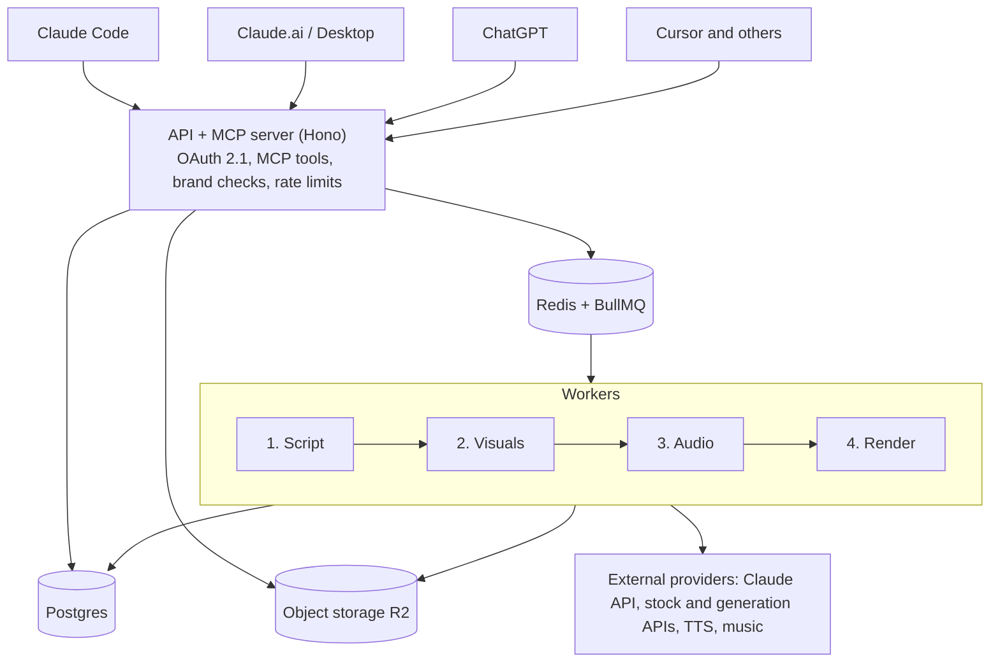
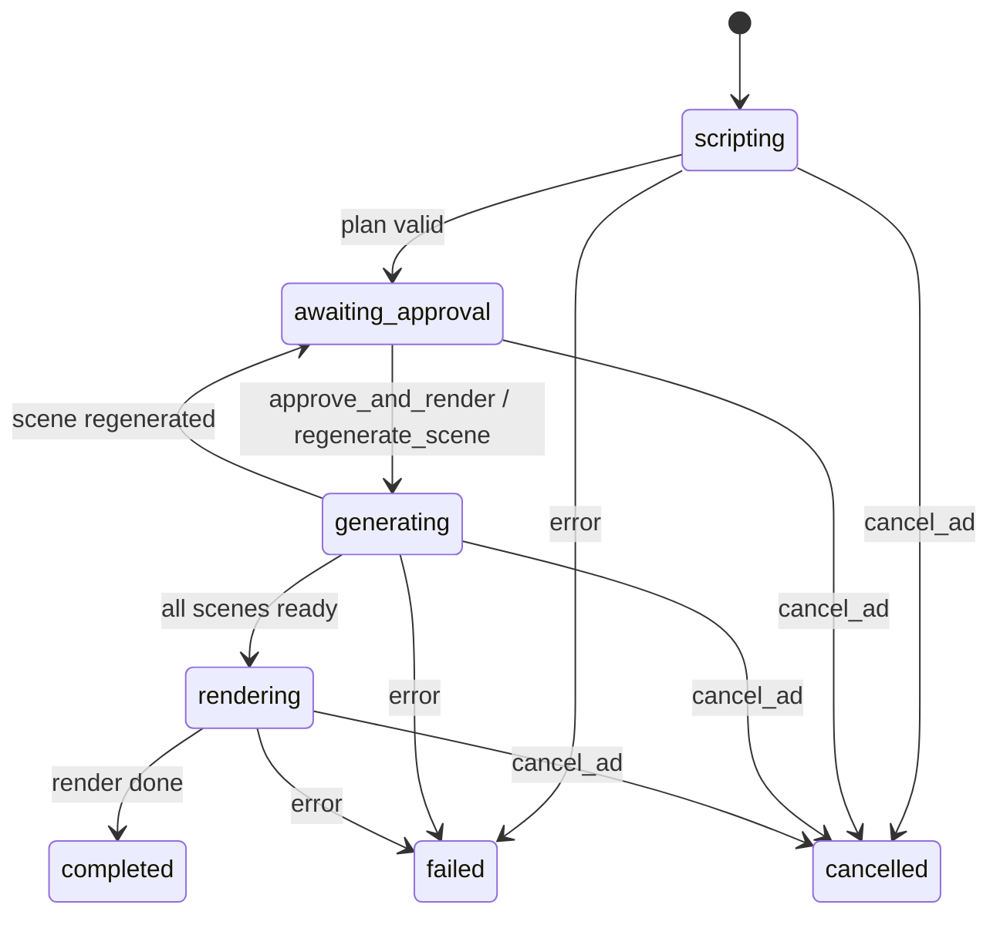

# Hookmint: Technical Design

Nov 16, 2026 · Will

**Version 2 (amended).** Adds a market analysis and a moat strategy, and revises the pipeline, tools, data model, security, milestones and risks to match. Sections changed in v2 are marked *(v2)*.

**Version 3 (hardened).** Adds versioning and contracts, durable workflows and idempotency, tenant isolation, a deterministic-first rules engine, statistically defensible insights, a stricter security model, and compliance and provenance. Sections changed in v3 are marked *(v3)*. The product shape from v2 is unchanged.

## Overview and goals

Hookmint turns a text prompt plus a brand kit into a finished 15–30 second video ad, and exposes it as a remote MCP server so Claude Code, ChatGPT, Cursor and other MCP clients can call it.

**Goals**

- One hosted backend; every client is a thin adapter over it.
- Async jobs with a human review gate: the script is approved before the costly render.
- Deterministic branding: logo, text, captions and CTA are composited in code, not generated by a video model.
- Output in 9:16, 1:1 and 16:9 from one template.

**v2 goals:** no paid generation without a visible cost and a preview; every ad checked against the brand's own rules before spend; variants that differ on one stated idea; and ad results fed back so each brand's winning patterns accumulate.

**Non-goals (v1)**

- Direct publishing to ad platforms.
- Long-form video (over 60 seconds).
- A full timeline editor. Edits are script and per-scene regeneration only.
- Self-hosted model inference. Providers are called through their APIs.

**Stack:** TypeScript, Node 22, the official MCP TypeScript SDK, Hono for HTTP, Zod for schemas, BullMQ on Redis for jobs, Postgres for state, S3-compatible storage (Cloudflare R2), Remotion for rendering.

## Market analysis and moat strategy (v2)

Existing generators compete on avatars, languages and speed, and they stop at "download MP4". The gaps are in output quality control, variety and learning from results. Pricing below is omitted because sources conflict; confirm on each vendor's page.

| Tool | Known for | Gap |
| --- | --- | --- |
| [Creatify](https://computingforgeeks.com/best-ai-video-ad-generators/) | Product URL to ad, batch variations, competitor tracker | Variations remix the same assets |
| [Arcads](https://www.arcads.ai/blog/ai-ad-creative-platform) | 300+ AI actors, high-volume UGC hooks | Cannot show physical product demos |
| [HeyGen](https://www.heygen.com/blog/best-ai-video-generator-for-ads) | Avatars, 175+ languages with lip-sync | Presenter-style, not a performance workflow |
| [Runway](https://heyoz.com/blogs/best-ai-video-generator-for-ads) | Cinematic brand spots | No brand rules, testing or variants |
| [AdCreative.ai](https://g2.com/products/adcreative-ai/reviews) | Speed, static and display creative | Reviews cite low usable yield |

**Unsolved pains.** Evidence is thin (vendor blogs, a few G2 reviews, press). *Inferred* items need interview validation.

| Pain | Evidence | Addressed by |
| --- | --- | --- |
| Low usable yield, wasted spend | [G2 reviews](https://g2.com/products/adcreative-ai/reviews), [G2 VideoGen](https://www.g2.com/products/videogen/reviews) | Cost-safe drafts, estimates, refunds |
| Uncanny or off-brand output | [McDonald's pulled AI ad](https://www.techradar.com/ai-platforms-assistants/mcdonalds-pulls-ai-generated-christmas-ad-after-backlash-over-soulless-visuals-and-holiday-chaos) | Brand rules and pre-spend checks |
| Sameness and creative fatigue | [Busyseed](https://www.busyseed.com/does-meta-penalize-llm-generated-ads-how-human-creative-really-performs) (vendor-sourced) | Idea-level variants with de-duplication |
| No learning loop, unclear what worked | [Brainlabs via PPC Land](https://ppc.land/brainlabs-warns-metas-ai-creative-could-leave-brands-unsure-what-worked/) | Performance feedback loop |
| Platform-forced AI creative | [Shopifreaks](https://www.shopifreaks.com/meta-advantage-is-forcing-unwanted-ai-creative-on-brands/) | User-controlled, auditable generation |
| Disclosure and compliance risk | Inferred; no authoritative rule text found | Claim checks, provenance record |
| Credit-burn anxiety | Inferred | Estimates before every spend |
| Tool silos | Inferred | Agent-native MCP workflow |

**Moat features, strongest first.** A moat gets harder to copy as usage grows.

| # | Feature | Why it compounds | Milestone |
| --- | --- | --- | --- |
| 1 | Performance feedback loop: ad-account metrics joined to each ad's hook, angle and variant | Per-brand winning patterns that only usage produces | M7 (data model from M1) |
| 2 | Brand memory with enforceable rules: banned claims, tone examples, past winners | Rules and history accumulate per customer | M3 |
| 3 | Idea-level variants, de-duplicated, each testing one named variable | Makes results measurable and avoids fatigue | M4 |
| 4 | Cost-safe drafts: free storyboard preview, estimate before spend, refund on rejected scenes | Trust; hard to match for credit-based rivals | M2 |
| 5 | Agent-native workflow through MCP | Distribution; not a moat alone | M1 (done) |
| 6 | Vertical depth in one niche (templates, rules, benchmarks) | Niche data and compliance knowledge | After M7 |

The first three are shippable in weeks. The feedback loop is the real moat, so every asset is tagged with `hook_id`, `angle` and `variant_group_id` from the first release, before any ad-platform integration exists.

## Architecture



Clients call only the API and MCP server. It writes job state to Postgres and enqueues work in Redis; workers run the four pipeline stages and write results to Postgres and object storage. Provider keys exist only in the workers.

## Contracts, versioning and compatibility (v3)

Every interface that a client, a worker stage or a stored record depends on carries an explicit version, so providers, models, templates and ad platforms can change without rewriting the job pipeline.

| Contract | Version marker | Compatibility rule |
| --- | --- | --- |
| REST API | `/v1` path prefix | Additive fields allowed; a breaking change ships as `/v2` |
| MCP tools | Stable tool names, `schema_version` in every result | A breaking change adds a new tool name; the old one stays listed with a deprecation warning |
| ScenePlan | `schema_version` field | Older plans are upgraded on read by a migration function |
| Brand kit and rules | Integer `version` per kit and rule set | Findings record the rule version that produced them |
| Render template | `template_id@semver`, pinned Remotion and Node versions | A render is reproducible from its stored template version |
| Insight methodology | `method_version` on each insight | Old insights stay readable; recomputation creates new rows |
| Provider adapters | Capability descriptor version | See the provider registry below |

**Rules**

- **One source of truth.** Zod definitions in `packages/core` generate the MCP JSON Schemas and the OpenAPI spec. REST routes and MCP handlers both call one shared service layer and contain no business logic of their own, so the two cannot drift.
- **Deprecation policy.** A deprecated tool or API version stays supported for a fixed window (proposed: 6 months) and returns a `warnings[]` entry in every result naming the replacement and the end date.
- **Contract tests.** CI runs a raw MCP test client plus scripted checks against Claude Code, Claude Desktop, ChatGPT and Cursor. Snapshots of the generated JSON Schemas fail the build on any unintended change.
- **Thin MCP adapter.** Capability negotiation happens at initialize. Tools are the lowest common denominator: the server does not depend on elicitation or resources. Progress notifications and signed webhooks are optional additions. REST and OpenAPI remain the fallback for clients with weak MCP support.
- **Result conventions.** Every result has structured data plus a plain-text summary, cursor pagination for lists, and a fixed error taxonomy: `invalid_input`, `not_found`, `conflict`, `forbidden`, `insufficient_credits`, `rate_limited` (with `retry_after`), `blocked_by_rule` and `provider_unavailable`.

## Generation pipeline

Every ad is described by one **scene plan** (JSON). The LLM writes it, the user can edit it, and the renderer consumes it, so the plan is the contract between all stages.

| Stage | Input | Output | Provider (swappable) |
| --- | --- | --- | --- |
| 1. Script | prompt, brand kit, duration | scene plan | Claude API with structured output |
| 2. Visuals | scene.visual\_prompt | clip or image per scene | Stock search (Pexels), image gen, or video gen (Veo, Runway, Luma) |
| 3. Voiceover | scene.voiceover text | audio file + word timings | ElevenLabs or OpenAI TTS |
| 4. Music | tone, duration | audio bed | Licensed library |
| 5. Captions | voiceover timings | caption track | Derived from TTS timings, Whisper as fallback |
| 6. Render | plan + assets + brand kit | MP4 per aspect ratio | Remotion |

Providers sit behind small interfaces (`ScriptProvider`, `VisualProvider`, `VoiceProvider`) so a model can be replaced without touching the job code.

```ts
const Scene = z.object({
  id: z.string(),
  duration_s: z.number().min(1).max(10),
  visual_prompt: z.string(),
  visual_source: z.enum(["stock", "image_gen", "video_gen", "upload"]),
  voiceover: z.string(),
  on_screen_text: z.string().optional(),
  claims: z.array(z.string()).default([]), // factual or offer claims, matched against brand rules
});

const VariantDefinition = z.object({
  tested_variable: z.enum(["hook", "angle", "offer", "cta", "visual_style"]),
  base_ad_id: z.string(),
  diff: z.array(z.object({ path: z.string(), from: z.unknown(), to: z.unknown() })), // computed, never model-written
});

const ScenePlan = z.object({
  schema_version: z.literal("1.1"),                      // upgraded on read when older (v3)
  template: z.object({ id: z.string(), version: z.string() }), // pinned render template (v3)
  hook: z.string(),
  hook_id: z.string(),            // stable id of the hook idea
  angle: z.string(),              // e.g. "price", "social proof", "problem-solution"
  variant_group_id: z.string(),   // ads that test one variable against each other
  variant: VariantDefinition.optional(), // present on variants; diff is computed by the diff engine (v3)
  cta: z.object({ text: z.string(), url: z.string().url().optional() }),
  aspect_ratios: z.array(z.enum(["9:16", "1:1", "16:9"])),
  scenes: z.array(Scene).min(2).max(8),
});
```

The plan is validated with Zod before any paid generation call. Total scene duration must match the requested ad length within 1 second.

**Pre-spend stages added in v2.** These run before any paid generation, so rejected ideas cost almost nothing.

| Stage | What it does | Cost |
| --- | --- | --- |
| Rules check (deterministic) | Runs enforceable brand rules over every text field: banned words and phrases, regex rules, required disclaimers, forbidden claims. Returns findings with rule ID, rule version and the quoted span. | None |
| Semantic check (LLM) | Tone and meaning checks that rules cannot express. Structured input and output only; see the rules engine section. | Text-only LLM call |
| Storyboard preview | Renders a free animatic: stills or stock thumbnails with captions and timing, no voice or video generation. | Near zero |
| Cost estimate | Sums expected provider cost and credits for the plan and shows it before `approve_and_render`. | None |
| Variant diff check (deterministic) | Computes the structured diff between a variant and its base and rejects the group if anything outside the tested variable differs. | None |

`hook_id`, `angle` and `variant_group_id` are copied onto every asset and render row. That tagging is what lets the feedback loop attribute ad-platform results to ideas, not just to files.

## Brand rules engine (v3)

Deterministic checks come first and decide anything they can. The LLM adds tone and meaning checks and never overrides a deterministic result.

- **Enforceable rules** (`brand_rules`): banned word or phrase lists, regex rules, required disclaimers, forbidden claims matched against `scene.claims`. These can produce `block` findings.
- **Examples** (`brand_examples`): tone samples and past winners. They guide generation and never block anything. This replaces the v2 `past_winner` rule type.
- **Semantic check:** the model gets rule text and plan text as quoted fields in structured JSON, has no tools, and must return JSON that validates against a schema. Every finding must cite a rule ID and a quote that appears verbatim in the plan; findings that do not are discarded.
- **Finding fields:** `severity` (info, warn, block), `rule_id`, `rule_version`, `method` (deterministic or llm), `confidence` (llm only), `evidence_quote`, `scene_id`, `suggested_fix` and `advisory: true`. Findings are advisory and are not legal advice.
- **Versioning:** editing a rule creates a new version. A stored finding keeps the version that produced it.
- **Testing:** golden test cases for every rule type run in CI. The semantic checker is scored against a labelled set, and precision and recall are reported before a prompt or model change ships.

## Experimentation and insights (v3)

The feedback loop is the main moat, so it has to be right. Insights are computed statistically; the LLM only narrates them.

- **Variant definition and diff engine.** Each tested variable maps to a set of plan fields allowed to differ (for example `hook` allows the hook text and the first scene's voiceover and on-screen text). The engine computes the diff against the base plan and rejects the variant if any other field differs. A text-similarity check on the tested field is a secondary guard against near-duplicates, with a threshold to tune.
- **Launch mode.** Record how variants were launched: `platform_experiment`, `same_ad_set` or `separate`. Only the first two support a causal comparison; `separate` results are labelled observational.
- **Before launch.** For a chosen minimum detectable effect and baseline rate, compute the sample size needed and show it to the user, so an underpowered test is visible up front.
- **Reporting.** Intervals for each metric, not point estimates alone. Multiple-comparison correction (Holm or Benjamini-Hochberg) across variants. Shrinkage of estimates when the best of many variants is reported, to limit winner's curse.
- **Seasonality and attribution.** Compare only concurrent date windows. Store attribution window, timezone, currency, platform API version and metric definition version on every snapshot.
- **Thresholds per metric.** Click-through rate, conversion rate and cost per result each have their own minimum impressions or conversions in `metric_thresholds`. Below the threshold the answer is "insufficient data".
- **LLM narration only.** The narration step receives computed insight rows and may not add patterns. Each sentence it writes maps to an insight ID.
- **Pooled benchmarks.** Opt-in, revocable consent, aggregates only, and a minimum number of contributing brands (k-anonymity; value to decide) before any figure is shown.

## Providers, renderer and templates (v3)

**Provider registry.** Each provider adapter declares its capabilities (script, image, video, voice, music), a versioned cost catalog entry, measured latency, quality tier, moderation support, license terms and status (active, canary, deprecated). Routing can send a small share of traffic to a canary provider and falls back along a chain, for example video generation, then image generation, then stock. Each adapter has contract tests against recorded fixtures, and every call stores its actual cost in `provider_calls`.

**Renderer and templates.**

- Templates are versioned (`template_id@semver`) and the Remotion and Node versions are pinned and stored as `renderer_version`.
- Golden-frame and visual-regression tests run per template and aspect ratio.
- Each template carries safe-zone metadata per aspect ratio, and the renderer checks caption contrast, reading speed and minimum font size.
- Text layout supports localization and right-to-left scripts, with font fallbacks.
- Content provenance metadata (C2PA content credentials) is embedded in outputs where the toolchain supports it.

## MCP tool specification

Seven core tools (v1) plus the v2 tools below, all returning quickly. Anything slow returns a `job_id` and the client polls. Transport is Streamable HTTP for remote use, with stdio for local development.

| Tool | Input | Returns | Notes |
| --- | --- | --- | --- |
| `create_brand_kit` | name, logo\_url, colors\[\], font, tone | `brand_kit_id` | Reusable across ads |
| `create_ad` | prompt, brand\_kit\_id?, duration\_s, aspect\_ratios\[\] | `job_id`, status `scripting` | Runs stage 1 only, then pauses for review |
| `get_ad_status` | job\_id | status, progress %, scene plan, preview URLs, error | Read-only, idempotent |
| `update_script` | job\_id, scene edits | updated plan | Only while status is `awaiting_approval` |
| `regenerate_scene` | job\_id, scene\_id, instruction | status `generating` | Re-runs one scene's visual and voice |
| `approve_and_render` | job\_id | status `rendering` | Starts the paid stages and final render |
| `list_ads` | limit, cursor | ads\[\] | Account history |

**Tool design rules**

- Descriptions state when to call the tool and what happens next ("returns a job\_id; poll `get_ad_status`"). Clients use them as their only UI.
- Inputs are Zod schemas converted to JSON Schema by the SDK; every field has a `.describe()`.
- Errors are returned as tool results with `isError: true` and a plain-language message, never as thrown exceptions.
- Video files are never returned inline. Results carry signed CDN URLs that expire after 15 minutes and are refreshed with \`get\_download\_url\`.
- Spending tools (`approve_and_render`, `regenerate_scene`) are annotated as non-read-only so clients can ask for confirmation.

**Tools added in v2 and revised in v3**

| Tool | Input | Returns | Scope |
| --- | --- | --- | --- |
| `set_brand_rules` | brand\_kit\_id, rules\[\] (banned\_phrase, regex, required\_disclaimer, forbidden\_claim), examples\[\] (tone, past winners) | new rule-set version | `brand:write` |
| `check_ad` | job\_id, plan\_version (optional) | findings\[\]: severity, scene\_id, rule\_id, rule\_version, method, confidence, evidence\_quote, suggested\_fix, `advisory: true` | `ads:read` |
| `get_storyboard` | job\_id | animatic URL (short-lived) | `ads:read` |
| `estimate_cost` | job\_id, plan\_version (optional) | credits, breakdown by stage, cost-catalog version | `ads:read` |
| `create_variants` | job\_id, count, tested\_variable, idempotency\_key | `variant_group_id`, variants\[\] each with job\_id and its computed `variant.diff` | `ads:create` |
| `cancel_ad` | job\_id | status; reservation released for unstarted stages | `ads:create` |
| `get_download_url` | render\_id | fresh short-lived URL | `ads:read` |
| `export_provenance` | job\_id | provenance report: providers, models, prompts, licenses, renderer version | `ads:read` |
| `connect_ad_account` | platform (meta, tiktok, google) | `authorization_url`, `connection_id`, `expires_at` | `ad_accounts:connect` |
| `list_ad_accounts` | none | connections and their status | `ad_accounts:connect` |
| `link_ad` | job\_id, render\_id or aspect\_ratio (one required), platform, platform\_ad\_id, launch\_mode | `link_id` | `ads:create` |
| `get_performance` | variant\_group\_id or brand\_kit\_id, date range | per variant: metrics with intervals, sample sizes, launch\_mode, causal or observational label, attribution window, metric-definition version | `insights:read` |
| `get_insights` | brand\_kit\_id | insights with method\_version, sample size and interval, or `insufficient_data` | `insights:read` |

**Changes to existing tools**

- `create_ad` runs the deterministic rules check automatically and returns findings with the plan.
- `approve_and_render` needs the `ads:approve` and `spend` scopes, with step-up authentication. It takes `max_credits` and `idempotency_key` and refuses if the estimate exceeds the limit. A `block` finding stops the render unless the call passes `override_reason`, which is written to the audit log.
- `regenerate_scene` follows the gate described in the durable workflows section: `spend` scope, `confirm: true`, `max_credits` and `idempotency_key`; without `confirm` it only returns an estimate.
- `create_variants` returns each variant's computed diff and fails if anything outside `tested_variable` differs.
- `link_ad` replaces the v2 input of job and platform ad ID alone, which was ambiguous when one ad has several renders.
- `connect_ad_account` returns an authorization URL carrying a single-use `state` bound to the account and session and a PKCE `code_challenge`. The server's callback validates `state`, exchanges the code with the `code_verifier`, and stores the tokens encrypted. The tool itself never sees tokens.
- `get_insights` always reports sample size and interval, and says when data is too thin to conclude anything.
- **Core tool scopes:** `create_brand_kit` needs `brand:write`; `create_ad`, `update_script` and `cancel_ad` need `ads:create`; `get_ad_status` and `list_ads` need `ads:read`.
- **Conventions for all tools:** mutating tools accept `idempotency_key`; every result carries `schema_version` and `warnings[]`; lists use cursors; errors use the fixed taxonomy.

## Job lifecycle



`create_ad` runs only the scripting stage, then the job stops at awaiting approval. `update_script` is accepted only in that state. `regenerate_scene` sends the job to generating and back; `approve_and_render` moves it forward, reserves credits and starts the paid stages. Any stage error moves the job to failed and refunds unspent credits. Workers retry transient provider errors up to three times before failing a stage.

**v2 changes.** The state machine keeps the same six states. The brand check, storyboard preview and cost estimate run inside `scripting`, so a job reaches `awaiting_approval` already carrying its findings and estimate. A `block` finding prevents `approve_and_render` until the plan is edited or an override reason is given. `create_variants` spawns N jobs that share one `variant_group_id`, and each follows this lifecycle independently. Linking a finished ad to an ad-platform ad is metadata on a completed job, not a new state.

**v3 change.** `cancel_ad` adds a seventh state, `cancelled`, reachable from any non-terminal state. The drawing above shows the six v2 states. Every transition is a version-checked write that also writes an outbox row, as described next.

## Durable workflows and idempotency (v3)

Postgres is the source of truth for job state. The queue is only a transport, so a crash or a duplicate request must never leave state, queue and spend out of step.

| Concern | Mechanism |
| --- | --- |
| Duplicate requests | `idempotency_key` is required on `create_ad`, `approve_and_render`, `regenerate_scene` and `create_variants`. The key, a hash of the request and the response go in `idempotency_keys`. The same key with the same body returns the stored result; with a different body it returns `conflict`. Keys are kept for a fixed window (proposed: 24 hours). |
| Concurrent transitions | `ads.version` is checked on every transition: `UPDATE ... WHERE id = ? AND version = ? AND status = ?`. The losing request gets `conflict`. |
| State and queue consistency | Transactional outbox. The status change and an `outbox` row commit together; a relay publishes to BullMQ and marks the row sent. Consumers de-duplicate by job key. |
| Crashed workers | Job leases with heartbeats. An expired lease returns the job to the queue, up to a maximum attempt count. |
| Cancellation and timeouts | A `cancel_ad` tool and per-stage timeouts. Cancelling releases the reservation for stages that have not started. |
| Retries | A retry budget per stage with exponential backoff and jitter. Non-retryable error classes fail fast. Exhausted jobs go to a dead-letter queue and raise an alert. |
| Double spend | Each provider call has a deterministic key (ad, scene, plan version, stage) written to `provider_calls` before the call. A retry finds the finished row and reuses its result. The provider's own idempotency key is passed when it supports one. |
| Credits | `credit_reservations` (held, settled, released) is separate from the append-only `credit_ledger`. Settle on completion; release the unspent remainder on failure or cancellation. |
| Fairness | Per-tenant concurrency limits and weighted queues, so one tenant cannot starve the others. |

**`regenerate_scene` spends, so it passes the same gate as approval.** It needs the `spend` scope, an `idempotency_key`, `confirm: true` and `max_credits`. Without `confirm` it returns an estimate and spends nothing. Each job has a regeneration budget (value to decide) so one ad cannot loop indefinitely.

**Later option.** If workflows grow past a queue and a state machine (multi-step approvals, long waits, human tasks), move orchestration to Temporal or Inngest. The explicit state machine and `provider_calls` table keep that migration small.

## Data model

Postgres holds all durable state. Binary assets live in object storage and are referenced by key.

| Table | Key columns | Purpose |
| --- | --- | --- |
| `accounts` | id, plan | Billing owner; balance is derived from the ledger |
| `api_keys` / `oauth_grants` | account\_id, hash, scopes, audience, expires\_at | Auth |
| `brand_kits` | id, account\_id, version, logo\_key, colors, font, tone | Reusable branding |
| `ads` | id, account\_id, brand\_kit\_id, prompt, status, version, current\_plan\_version, hook\_id, angle, variant\_group\_id, error | One row per job; `version` guards state transitions |
| `plan_versions` | id, account\_id, ad\_id, version, schema\_version, plan (jsonb), created\_by | Immutable plans; unique on (ad\_id, version) |
| `assets` | id, account\_id, ad\_id, scene\_id, plan\_version, kind, storage\_key, provider, model, model\_version, prompt, license, license\_url, renderer\_version, cost\_cents | Every generated file with its provenance |
| `renders` | id, account\_id, ad\_id, aspect\_ratio, template\_id, template\_version, renderer\_version, storage\_key, duration\_s | Final MP4s |
| `credit_ledger` | id, account\_id, ad\_id, delta, reason | Append-only record of credit movements |
| `credit_reservations` | id, account\_id, ad\_id, amount, status (held, settled, released), expires\_at | Credits held while work runs |
| `provider_calls` | id, account\_id, ad\_id, call\_key (unique), provider, model, status, error\_class, latency\_ms, cost\_cents, request\_hash, result\_ref | Idempotency, cost and latency per provider call |
| `idempotency_keys` | account\_id, key, request\_hash, response, created\_at | Replay protection; unique on (account\_id, key) |
| `outbox` | id, account\_id, topic, payload, created\_at, sent\_at | Transactional hand-off to the queue |

**Rules**

- **Tenant isolation.** Every tenant-owned table has `account_id NOT NULL` and a Postgres row-level security policy that compares it with the account set for the session (`app.account_id`). The API sets it per request and workers set it per job. Application-level `WHERE account_id = ...` filters stay as a second layer. Tests confirm that a query under one account cannot read another account's rows.
- **Immutable plans.** An edit inserts a new `plan_versions` row and moves `ads.current_plan_version`. The v1 `ads.plan` column is removed.
- **Integrity.** Foreign keys on every reference, unique constraints as listed, and indexes on (account\_id, created\_at), (ad\_id, status) and every lookup key.
- **Spend trail.** A `provider_calls` row is written before each provider call and an `assets` row after it, both with cost. Credits are reserved when `approve_and_render` is called, then settled or released; the balance is derived from the ledger.
- **Retention, deletion and export.** A retention job removes assets and renders after a configurable window. Per-account and per-brand deletion and export paths are described under compliance.
- **Audit log.** Insert-only database grants. Each row stores a hash of the previous row for its account, forming a hash chain, and the chain head is anchored periodically to write-once storage so tampering is detectable.

**Tables added in v2 and revised in v3**

| Table | Key columns | Purpose |
| --- | --- | --- |
| `brand_rules` | id, account\_id, brand\_kit\_id, version, type, pattern, severity, active | Enforceable rules |
| `brand_examples` | id, account\_id, brand\_kit\_id, kind (tone, past\_winner), text | Guidance for generation; never blocks |
| `check_findings` | id, account\_id, ad\_id, plan\_version, scene\_id, rule\_id, rule\_version, method, confidence, severity, evidence\_quote, message, resolved | Output of the checks |
| `variant_groups` | id, account\_id, brand\_kit\_id, tested\_variable, base\_ad\_id | Ads that test one variable against each other |
| `ad_accounts` | id, account\_id, platform, external\_id, token\_enc, key\_version, scopes, status, expires\_at | Connected ad platforms; tokens encrypted |
| `ad_links` | id, account\_id, ad\_id, render\_id, aspect\_ratio, platform, platform\_ad\_id, launch\_mode | Ties one render to one live ad |
| `performance_snapshots` | id, account\_id, ad\_link\_id, date, spend, impressions, clicks, conversions, currency, timezone, attribution\_window, platform\_api\_version, metric\_definition\_version | Daily metrics; corrections append new rows |
| `metric_thresholds` | metric, min\_impressions, min\_conversions, method\_version | Per-metric gate for insights |
| `insights` | id, account\_id, brand\_kit\_id, pattern, metric, effect, interval\_low, interval\_high, sample\_size, method\_version, computed\_at | Winning patterns with their evidence |
| `consents` | account\_id, kind (pooled\_benchmarks, voice\_likeness), granted\_at, revoked\_at | Opt-ins that can be revoked |
| `audit_log` | id, account\_id, actor, action, ad\_id, detail, prev\_hash, hash | Approvals, overrides and spend; tamper-evident |

**v2 rules**

- `assets` stores provider, model, model version, prompt, license and renderer version, which gives a provenance record per asset that can be exported.
- An insight is stored only when its sample size passes that metric's threshold, and it always carries the sample size, interval and `method_version`.
- Insights are computed per brand. Pooled benchmarks need an active `consents` row and a minimum number of contributing brands, and show aggregates only.
- Provider tokens are encrypted with envelope encryption; `key_version` supports rotation.

## Auth, security and rate limits (v3)

Remote MCP clients authenticate with OAuth 2.1; developers and scripts can use API keys. Provider keys never leave the server.

- **OAuth 2.1 with PKCE.** Access tokens are audience-bound to this server using resource indicators (RFC 8707), and the server publishes protected-resource metadata so clients can discover the authorization server. Dynamic client registration is allowed but rate-limited, with client allowlisting available and a manual-registration path for sensitive tenants.
- **Scopes.** `ads:read`, `ads:create`, `ads:approve`, `spend`, `brand:read`, `brand:write`, `insights:read`, `ad_accounts:connect`. The spending tools need step-up authentication: fresh consent for `spend` and `ads:approve`, repeated after an idle period.
- **API keys** are shown once, stored as hashes, scoped, expiring and rotatable.
- **Tenant isolation.** Row-level security in Postgres plus account-prefixed storage keys; see the data model.
- **Short-lived URLs.** Private creative is served through CDN tokens that expire after 15 minutes (proposed) and are refreshed with `get_download_url`. A 24-hour URL would let a leaked link expose an unreleased ad for a day.
- **Uploads.** PNG and JPG are fully decoded and re-encoded, with a size limit of 5 MB. SVG is rasterized to PNG on upload (or sanitized with a strict allowlist if vector output is needed). Every upload is scanned for malware before it is stored.
- **SSRF protection.** Every fetch of a user-supplied URL (such as `logo_url`) goes through one fetcher that allows only https, resolves DNS itself, rejects private, loopback and link-local addresses (rechecked after each redirect), caps time and size, and sends traffic through an egress proxy. CTA URLs are validated and never fetched.
- **Moderation.** Prompts and uploads are moderated before any paid call. Generated images, video and audio are moderated again before they are shown or rendered; a blocked output refunds its credits.
- **Rate limits and spend guard.** Per-account limits on creation and concurrent renders, plus a hard per-job cost ceiling that aborts and refunds.
- **Secrets and rotation.** Secrets live in the host's secret store. Provider keys, token-encryption keys and webhook secrets each have a documented rotation runbook.
- **Webhooks**, inbound from providers and outbound to clients, carry an HMAC signature, a timestamp and a replay window.
- **Untrusted data.** Brand rules, scene text, metrics, ad-platform responses and tool outputs are treated as data. They reach models as structured JSON fields, the checker model has no tools, and its output must validate against a schema.

**v2 additions**

- **Ad-platform tokens** are encrypted at rest with envelope encryption and a `key_version` for rotation. The first release requests read-only reporting scopes, with no permission to create or change ads.
- **Disconnect** deletes the stored tokens immediately and offers to purge the imported metrics.
- **Audit log** is an append-only hash chain recording approvals, override reasons, spend, scope step-ups and connection events.
- **Platform terms.** Each integration is built against that platform's API terms and app review process, which are confirmed before M7.

## Compliance, privacy and provenance (v3)

This section lists the engineering controls. Legal review is still needed for the rules that apply to each market and ad platform.

- **AI disclosure.** Each render's metadata records that it is AI-generated or AI-assisted and which elements were. Labeling follows a per-platform policy table that legal review keeps current, for example EU transparency obligations and each ad platform's own labeling rules.
- **Voice and likeness.** Only licensed or stock voices and avatars, or a user's own voice with a recorded consent in `consents`. No voice cloning without that record.
- **Music and stock.** License and license URL are stored for every asset and are exportable.
- **Provenance export.** `export_provenance` returns providers, models, prompts, licenses and renderer version for an ad. C2PA content credentials are embedded where supported.
- **Retention, deletion and export.** Retention windows are configurable. Deleting a brand or account removes its assets, renders, findings and ad-platform tokens, and writes a deletion record to the audit log without personal data. Customers can export brand kits and ad data in a portable format. Backups expire on a stated schedule.
- **Providers and data use.** Before a provider is enabled, confirm its data-use terms (no training on customer data) and add it to the subprocessor list used for data processing agreements.
- **Regional hosting.** Storage and processing region becomes a tenant setting if customers require it; the decision depends on the target segment.
- **Advisory checks.** Brand-rule findings are advisory and are not legal advice; a human approval step stays in the flow.

## Cross-platform integration

The MCP server is the main adapter. Clients that don't speak MCP get an OpenAPI spec generated from the same REST routes.

| Client | Integration | What ships |
| --- | --- | --- |
| Claude Code | Claude Code plugin wrapping the remote MCP server | `.claude-plugin/plugin.json`, MCP config, `/make-ad` command, a skill with ad-writing and brand guidance |
| Claude.ai, Claude Desktop | Custom connector pointing at the MCP URL | Docs page with the URL and setup steps |
| ChatGPT | MCP-based app or connector; Custom GPT Actions as a fallback | Same MCP URL; OpenAPI spec for Actions |
| Cursor, VS Code, Windsurf, Cline | MCP config entry | Copy-paste JSON snippet per client |
| Anything else | REST API | OpenAPI spec and API key |

**Client differences to handle**

- Some clients render only text. Every result includes a plain-text summary and the preview URL as a link.
- Tool call time limits vary, so no tool blocks on generation.
- Client support for MCP features such as elicitation and resources is uneven. The server relies only on tools.

**v3 compatibility.** Versioning, the contract-test matrix and the REST fallback are described under contracts and compatibility. ChatGPT and Claude.ai need a public HTTPS URL and OAuth. The Claude Code plugin pins a range of tool-schema versions, so a server upgrade does not break installed plugins.

## Infrastructure, cost and billing

Three deployable units: the API and MCP server (stateless, small), the job workers (CPU for rendering, network-bound for provider calls), and the data stores.

| Unit | Runs | Suggested host |
| --- | --- | --- |
| API + MCP server | Hono app, OAuth, tool handlers | Railway, Cloud Run or Cloudflare Workers |
| Workers | BullMQ consumers, provider calls, Remotion render | Railway or Cloud Run containers; Remotion Lambda if render load grows |
| Postgres | Durable state | Managed Postgres |
| Redis | Queue and rate limits | Managed Redis |
| Object storage | Assets and MP4s | Cloudflare R2 with signed URLs |

**Cost model.** Video-generation provider calls are the largest cost per ad, followed by TTS and render compute. Prices change often, so the pipeline stores each call's cost in `assets.cost_cents`. Plan pricing is set from measured cost per ad after the first 50 test renders, not from list prices.

**Billing.** Prepaid credits. One credit buys a fixed amount of generation, and `approve_and_render` reserves credits before work starts. Stock-based ads cost fewer credits than video-generated ads, which lets users pick cheaper scenes.

**Observability.** Structured logs with `job_id`, per-stage timings, provider error rates, and an alert when a stage's failure rate or cost per ad crosses a threshold.

**v2 workers.** Two scheduled jobs join the queue: a metrics sync that pulls ad-platform results daily for linked ads, and an insights job that recomputes winning patterns per brand when new snapshots arrive. Both are idempotent and safe to re-run.

**v3 infrastructure**

- **Hosting constraint.** Cloudflare Workers can run the stateless API and MCP server, but not BullMQ consumers or Remotion renders, which need long-running Node processes and a headless browser. Workers always run in separate containers (Railway, Cloud Run) or on Remotion Lambda, whatever hosts the API. The hosting decision therefore settles whether one platform can run both.
- **Scaling.** The API stays stateless. Workers autoscale on queue depth, separately from the API, with per-tenant queue fairness.
- **Data stores.** Postgres with connection pooling, a read replica for insight queries, and point-in-time backups. Redis with persistence enabled; the outbox, not Redis, is the source of truth for jobs. Explicit recovery point and recovery time objectives are set before launch.
- **Observability.** OpenTelemetry traces across API, queue, workers and provider calls, tagged with `job_id` and `account_id`. Service level objectives (for example time to script and render success rate) with alerts; targets to decide.
- **Delivery.** Feature flags for providers and features, blue/green deploys with backward-compatible migrations, and dependency and SBOM scanning in CI.

## Repo layout, milestones and risks

The scaffold is a pnpm monorepo. Providers are stubbed first so the full job flow works end to end before any paid API is connected.

```text
hookmint/
  packages/
    core/        Zod schemas, service layer, job state machine, provider interfaces, schema migrations
    brand/       brand kit, deterministic rules engine, semantic check (v3)
    variants/    variant generation and the diff engine (v3)
    insights/    metrics ingestion, attribution, statistics (v3)
    providers/   registry, stub + real script, visual, voice, ad-platform clients
    renderer/    Remotion project, versioned templates, golden-frame tests
  apps/
    server/      Hono API (/v1), OAuth, MCP adapter (Streamable HTTP + stdio)
    worker/      queue consumers, outbox relay, metrics sync, insights job
  db/            migrations, row-level security policies (v3)
  tests/
    contract/    raw MCP client + per-client checks, JSON Schema snapshots (v3)
  plugin/        Claude Code plugin: plugin.json, /make-ad, skill
  openapi/       generated from the Zod schemas
```

**Milestones**

1. **M1 Scaffold (done):** MCP server with seven tools, in-memory store, stub providers, smoke test.
2. **M2 Foundations:** `/v1` API and shared service layer, `schema_version` on plans and results, JSON Schema snapshots and a raw MCP contract test; Postgres with row-level security, `plan_versions`, idempotency keys, outbox, `provider_calls` and credit reservations; the real script stage (Claude API); `estimate_cost`, `get_storyboard` and `max_credits`. Exit: a repeated call spends once, a cross-tenant read test fails as it should, and the user sees cost and a preview before any paid call.
3. **M3 Brand rules engine:** deterministic rules, semantic check with citation requirement, rule versioning, golden tests, `set_brand_rules` and `check_ad`, override with audit log. Exit: a banned claim is caught before spend and the rule suite passes in CI.
4. **M4 Variants:** diff engine and `create_variants`. Exit: every variant differs from its base on exactly the stated variable, as computed.
5. **M5 Render core:** pinned Remotion template, stock footage, TTS and captions in all three aspect ratios, golden-frame tests, safe zones, output moderation, short-lived URLs and provenance metadata.
6. **M6 Auth, billing and scale:** audience-bound OAuth 2.1, scopes and step-up for spend, API keys, live credit ledger and reservations, rate limits, per-tenant fairness, cancellation, dead-letter queue, observability and backups. Contract-test matrix across the real clients.
7. **M7 Feedback loop (after interviews):** `connect_ad_account` with state and PKCE, metrics sync, statistics with intervals and correction, per-metric thresholds, `get_performance` and `get_insights`. Exit: insights with sample sizes for one real brand.
8. **M8 Packaging and depth:** Claude Code plugin, OpenAPI, setup docs, provider registry with canary routing and fallbacks, video-generation providers, compliance exports and templates for one niche.

**M2 status.** Built and tested in code (v0.2.0, 13 foundation checks, a lifecycle smoke test and a tool-schema snapshot, all passing): shared service layer used by both MCP tools and REST `/v1/ads`; `schema_version` and `warnings[]` on every result; idempotency keys; version-checked transitions; outbox with at-least-once redelivery that repeats no work or spend; `provider_calls` de-duplication with retry and jitter; credit reservations settled or released; `max_credits`, `estimate_cost`, `get_storyboard`, `cancel_ad`; `regenerate_scene` gated and budgeted; scopes; per-account isolation; a hash-chained audit log; plan upgrade on read.

Not yet done: a live run of the Claude providers (built in v0.5.0 and tested offline; needs an Anthropic API key), Postgres with row-level security (state sits behind a store class that Postgres will replace; row-level security is untested until a database is available), OAuth 2.1, and the cross-client contract matrix.

**M3 status.** Built and tested in code (v0.3.0, 10 brand checks plus the earlier suites, all passing): `set_brand_rules` and `check_ad`; deterministic rule types `banned_phrase`, `regex`, `forbidden_claim` and `required_disclaimer`, plus advisory `semantic` rules; versioned rule sets; findings with rule ID, rule version, quoted evidence, suggested fix and an advisory flag; `approve_and_render` refused with `blocked_by_rule` on blocking findings unless `override_reason` is given, in which case the override and the findings go into the audit log; examples (tone, past winners) stored separately and never blocking.

Where the build differs from the spec above:

- **Findings are derived, not stored.** They are recomputed from the current plan and rules on every read, so they cannot go stale. The `check_findings` table is not built; findings that were overridden are snapshotted into the audit log instead.
- **Rule version is per rule set,** not per rule. Saving rules replaces the set and bumps one version number.
- **Semantic checks are model-based and advisory.** The interface and the validator exist and are tested (a finding must cite a semantic rule and quote text that appears verbatim in the plan; severity is capped at warn; anything else is discarded). Since v0.5.0 a Claude-based checker runs in the background when a key is set; without one, semantic rules stay inactive and check\_ad reports semantic\_status "off".
- **Regex rules** are limited to 200 characters and reject nested quantifiers and backreferences. This is a best-effort guard, not a proof against catastrophic patterns.

**M4 status.** Built and tested in code (v0.4.0, 20 variant checks plus the earlier suites, all passing): `create_variants` (1 to 5 per call) and `POST /v1/ads/:id/variants`; a deterministic diff engine; variants created as ordinary ads that go through the same estimate, brand check and approval steps; a variant group that tests one variable; idempotent, concurrency-safe and tenant-isolated.

How it works:

- **The provider proposes, the engine decides.** A variant provider returns plans. For each one the diff engine flattens base and variant to field paths, computes the diff, and rejects the variant if any changed path is outside the tested variable's allowed set, if nothing changed, or if the change is too small. The diff stored on the variant is the engine's output, never the provider's. All variants in a call are created or none are.
- **Allowed fields.** `hook`: the hook text, `hook_id`, and the first scene's voiceover and on-screen text. `angle`: the angle label, the hook text, and every scene's voiceover, on-screen text and claims. `offer`: scene voiceover, on-screen text and claims. `cta`: the CTA text and URL. `visual_style`: scene visual prompts and visual sources. Durations, scene order, template, aspect ratios and everything else must match the base.
- **Server-owned fields.** Schema version, template and group id always come from the base. A hook variant gets a fresh `hook_id`; every other variant keeps the base's, because it is the same hook idea. `hook_id` and `variant_group_id` are now minted by the server for every ad.
- **Near-duplicates.** Word-level distance (0 to 1, order-insensitive) must be at least 0.2 between a variant and the base and between any two variants in the group. Identifiers are excluded from the measure.
- **Limits.** One group tests one variable, so a second call for a different variable on the same ad is a conflict. An ad can have at most 10 variants in total.

Limits to know about:

- **Meaning is not checked.** The distance measure compares words, so a paraphrase with different words passes as different. Catching same-meaning variants needs a model or embeddings, which is not built.
- **`angle` and `offer` are bundles.** They change several text fields together by design, so they isolate the idea, not a single field.
- **The variant provider uses Claude when a key is set (v0.5.0) and has only been tested offline.** The engine is the safety net that makes a real model safe to plug in.
- **Not built yet:** `launch_mode`, `link_ad` and performance attribution, which belong to M7.

**Claude providers status (v0.5.0).** Script writing, variant writing and the semantic brand check now call the Claude API when `ANTHROPIC_API_KEY` is set, and fall back to stubs when it is not. Built and tested offline against a fake HTTP layer (16 checks, plus two deliberate-breakage checks confirming the tests catch a leaked key and a blocking model finding). **It has never been run against the real API.** The key was not available in the build environment, so the writing quality, the prompts and the default model names are unverified until someone runs `npm run test:live`.

How it is kept safe:

- **One client.** Every call goes through a single client that sends the key only in a header, offers the model exactly one forced tool, and validates the answer against a schema. Errors carry the status and request id, never the key or the request.
- **Customer text is data.** System prompts are fixed constants. Prompts, brand rules, tone examples and ad text go only in the user message as JSON, and the system prompts tell the model to ignore instructions found there. Tests confirm injected text never reaches a system prompt.
- **Model output is untrusted.** Scripts get one repair attempt for wrong durations or ids, then fail the ad cleanly. Variant models return only the fields the tested variable may change; extra keys are stripped and the diff engine still proves the result. Ids are minted by the server.
- **Semantic checks degrade, never block.** They run in the background, cached per plan version and rule-set version, and `check_ad` reports `semantic_status`: `none` (no semantic rules), `off` (rules exist but no model is configured), `pending`, `done` or `unavailable`. A failed model call never fails an ad or blocks approval, and deterministic checks keep working.
- **Retries.** Rate limits and outages are retried with backoff, waiting at least as long as the provider asks.
- **Gateway variable.** The base URL comes only from `HOOKMINT_ANTHROPIC_BASE_URL`; `ANTHROPIC_BASE_URL` is ignored on purpose because other tools set it.

Known gaps: model token usage is counted on the client but not yet charged to credits or shown to users; the default models (`claude-sonnet-5-5`, `claude-haiku-5-5`) have not been confirmed against the API; and prompt quality needs human review of real output.

**M5 status (v0.6.0).** Real video rendering works. With `HOOKMINT_RENDERER=remotion`, approving an ad produces real MP4 files in 9:16, 1:1 and 16:9, downloadable through short-lived signed links, with a new `get_download_url` tool (14 tools). Built and tested: 16 render checks that make real videos in a real browser, plus the earlier suites. Driven end to end through the actual HTTP server: create, approve, render a 6-second 1080 by 1920 H.264 file, download it with a signed link, and see a tampered link refused.

What the template does: brand colour and name, headline from the scene's on-screen text, the voiceover as captions in a dark box, and a call-to-action button over the end of the last scene. Text is drawn by code, so it is always sharp and inside the safe area. Anything that would overflow is clipped, and the render notes say so.

What the tests prove:

- **Safe areas.** A layout probe renders a frame with every text box as solid white on black; no lit pixel may fall outside the safe area, for all three shapes, at the opening and at the call to action, with normal and deliberately over-long text. Breaking the safe-area container on purpose made this test fail with 14,832 stray pixels.
- **Real media.** A local image and a voiceover file are used when present, a local video clip works as a background, and only the scene that lacks media falls back to the brand gradient.
- **Output facts.** Codec, size, exact frame count and duration are checked with ffprobe.
- **Links.** A link names one render, one account and one expiry. Tampering with any part, expiry, another account's signature and an unknown render are all refused; fresh links come from `get_ad_status` and `get_download_url`; links are never stored.
- **Contrast.** White text on the caption box stays above 4.5:1 even over pure white video, and button text colour is chosen to meet 4.5:1 on any brand colour. The tests caught that near-black text could not do this (4.35:1 worst case), so button text is pure black or white.
- **Cancelled jobs.** A render that finishes after its ad was cancelled is deleted.

Security choices: the renderer **never fetches a URL**. It reads only local files inside one asset folder (realpath check, so symlinks cannot escape; extension and role allow-list; size cap) and serves them to the browser through random single-file tokens on localhost. Brand colours reach CSS only as plain hex. The file route is authorised by the signature alone and verifies it before touching the disk.

Differences from the spec above:

- **No golden-image tests.** Pixel-exact comparisons break across Chrome versions and fonts. Safe-area scans, contrast proofs and structural checks replace them. Golden frames can be added if a pinned browser is used in CI.
- **No output moderation.** It needs a moderation service, which does not exist yet. The pre-render checks cover text only.
- **Provenance is a tag, not C2PA.** Each MP4 carries a `description` tag stating it is AI-generated, with the ad, plan version, hook, template and the renderer actually used. Signed C2PA credentials are not built.
- **One font.** Logos arrived in v0.7.0. Only the bundled Inter font (SIL Open Font Licence) is used, and `brand.font` is ignored.
- **Accessibility is partial.** Contrast, minimum text size and reading speed are checked; localization and right-to-left layout are not.

Limits and open items:

- **Remotion licence.** Remotion is free for individuals and for-profit companies with up to 3 employees; larger for-profit companies need a paid company licence. Confirm eligibility before running this as a business.
- **No real footage or voice yet.** Visuals and voice are stubs, so videos are branded text on a gradient and silent unless local media is supplied.
- **Deployment.** The host needs Chrome or Chromium; no container image is built yet. Rendering takes roughly 10 to 30 seconds per short video here, one at a time by default.
- **Disk.** Finished files are kept until a retention job exists; none is built.
- **Downloads need the HTTP entry.** The stdio entry shows local file paths instead of links.
- **Set `HOOKMINT_URL_SECRET`** (32+ characters), or links stop working whenever the server restarts.

**M6, first slice: safe downloading, logos and remote media (v0.7.0).** The server can now fetch a user's or a provider's URL without letting that URL reach anything internal. Built on that: brand logos, and remote stills, clips and voiceovers for scenes. New tool `get_brand_kit` (15 tools). Tested with 26 network checks and 2 more browser checks; all earlier suites still pass.

The fetcher (`SafeFetcher`):

- **What it refuses.** Anything but https on the standard port, addresses with credentials, reserved names (localhost, .internal, .local and similar), and every private, loopback, link-local (including the 169.254.169.254 cloud metadata address), shared, documentation, multicast or reserved address, in IPv4 and IPv6, including IPv4 hidden inside IPv6 (mapped, NAT64, 6to4) and odd spellings such as `2130706433` or `0x7f.1`.
- **No DNS tricks.** The name is looked up once, every answer must be public, and the connection goes to that exact address with the original name used for the certificate check. A DNS answer that changes between the check and the connection cannot redirect it. Redirects are followed by hand and every hop is checked again.
- **Hard limits.** Total time, size (stopped as soon as the limit is passed, not after downloading), file type, no compressed bodies, no cookies, credentials or referer sent, no proxy used, certificates always verified.
- **Proven.** The tests include a real local HTTPS server with a throwaway certificate: redirects, size cut-offs, a server that never answers, one that drips data forever, an untrusted certificate and a certificate for the wrong name. Five safeguards were broken on purpose, one at a time (private-address check, pinning, SVG allow-list, redirect re-checks, path hiding), and a test failed each time.

What it protects:

- **Images** are decoded and re-encoded, so metadata and anything appended or hidden in the file is dropped. Only PNG, JPEG and WebP are accepted. SVG (which the image library would happily read), GIF, TIFF, animated files, truncated files, tiny files and pixel bombs are refused, and decoder error text is never shown to users.
- **Audio and video** are checked with ffprobe using a forced file format and a file-only protocol whitelist, so a crafted playlist cannot make it open anything. Codec, size and length limits apply.
- **Storage.** Files are stored under names the server chooses, in a folder per account; an address, an account id or a brand kit id can never choose a path.
- **Logos.** A logo address is checked immediately and a bad one is refused before anything is stored. The download then happens in the background; `get_brand_kit` reports `logo_status` as none, pending, ready, failed (with a plain reason) or unavailable. In videos the logo sits on a white chip so any logo stays readable on any brand colour, and tests show even extremely wide or tall logos cannot push anything outside the safe area.
- **Failures never fail an ad.** If a scene's download fails, that scene uses the brand gradient and the render notes say why. Local file paths are never shown to clients (a test caught previews leaking one).

Limits and open items:

- **Not yet run against the real internet.** The tests use local servers and fakes. The fetcher deliberately ignores proxy settings, so it will not work from an environment that only allows web access through a proxy, such as this build sandbox.
- **Parsing untrusted files in-process.** The image library and ffmpeg read files from outside. Run workers in a locked-down container with memory and CPU limits, and keep those packages updated. There is no malware scanning.
- **No fetch quotas.** Nothing yet limits how many logos or media files an account can make the server download, which is both a cost and an abuse risk. Per-account limits belong with the rate-limit work.
- **Disk.** Downloaded files are kept until a retention job exists.
- **SVG logos** are refused. Supporting them safely means rasterizing in a sandbox.
- **Still to do in M6:** Postgres with row-level security, OAuth 2.1 with audience-bound tokens, per-account rate limits and fetch quotas, fairness between accounts, a dead-letter queue, observability, and backups.

**Risks**

| Risk | Mitigation |
| --- | --- |
| Video-gen output is inconsistent or has garbled text | Composite all text and logos in Remotion; default to stock and image scenes |
| Provider cost spikes | Per-job cost ceiling, cost per call stored, versioned cost catalog, estimate before spend |
| Clients time out on long jobs | Async job pattern; no tool blocks on generation |
| Duplicate or crashed jobs double-spend (v3) | Idempotency keys, outbox, leases, `provider_calls` de-duplication, reservations |
| Cross-tenant data exposure (v3) | Row-level security plus application filters, isolation tests, account-prefixed storage |
| MCP spec and client behavior drift (v3) | Thin adapter, tools only, versioned schemas, contract-test matrix, REST fallback |
| SSRF, malicious uploads, prompt injection (v3) | Single hardened fetcher, SVG rasterized, malware scan, structured inputs, tool-less checker |
| Provider deprecation or quality change (v3) | Provider registry, canary routing, fallback chain, contract tests on fixtures |
| Feedback loop needs spend volume and may not show clear winners | Intervals, per-metric thresholds, "insufficient data" answers, start with brands that already run paid ads |
| False winners from noise, seasonality or many variants (v3) | Concurrent windows, multiple-comparison correction, shrinkage, observational label for non-experiment launches |
| Ad-platform API access, review and terms | Start read-only with one platform; confirm terms and app review before M7 |
| Market evidence is thin and partly vendor-written | 10 to 15 customer interviews before M7; re-rank M4 to M7 from the answers |
| Competitors copy the visible features | Invest first in what compounds: per-brand rules, tagged history, performance data |
| Rules check gives false confidence on legal compliance | Advisory label, not legal advice, human approval stays; legal review per market (v3) |
| Unlicensed voice, music or likeness in output (v3) | Licensed or consented sources only; license stored per asset; provenance export |

**Open questions**

**Decisions taken (2026-11-16).** These unblock M2. Each is a working assumption to revisit after the customer interviews, not a validated fact.

| Decision | Choice | Reason |
| --- | --- | --- |
| First customer | Local service businesses, cleaning companies first | Reachable first users and an existing audience; owners lack creative teams; a vertical gives room for niche rules and templates. Risk: small ad budgets give thin data, so pooled opt-in benchmarks within the vertical matter early. |
| Hosting | Railway for API and MCP server, workers, Postgres and Redis; Cloudflare R2 for storage | One platform runs the long-lived queue workers and Remotion containers, which Workers cannot. Revisit at scale. |
| Billing at launch | Invite-only; credits granted manually through the ledger; no payment processor yet | Keeps v1 small while the reservation and ledger logic is exercised for real. |
| First ad platform | Meta, read-only reporting | Widely used by local service advertisers; read-only keeps the app review lighter. API terms and review still to confirm. |
| Parameters | Deprecation window 6 months, signed-URL lifetime 15 minutes, idempotency-key retention 24 hours, regeneration budget 3 per ad | The proposed values; the regeneration budget is already the code default. |

Still open: minimum brands for pooled benchmarks, metric thresholds, SLO targets, RPO and RTO, regional hosting, and the first video-generation provider.

**Name: Hookmint.** Chosen after a screen of coined names. In searches on 2026-11-16 it was free on npm and PyPI, had no GitHub repositories or users with that name, and no product with the exact name turned up in a web search. Not yet checked: domains, trademark registries (USPTO, WIPO) and the Claude Code and MCP plugin listings. The "hook" and "mint" words also appear in crypto (for example Uniswap hooks and NFT minting), so check that confusion before launch. The npm package, MCP server name and repository directory are all `hookmint`.

- **Ideal first customer:** e-commerce brands, agencies or local service businesses? This sets the order of M3 to M7. *(blocks M2)*
- **Hosting target:** Railway, Cloud Run or Cloudflare Workers for the API, and where do workers and renders run? *(blocks M2)*
- **Billing at launch,** or invite-only for v1? *(blocks M2)*
- **First ad platform** for the feedback loop, and who owns the API app review? *(blocks M7 scoping)*
- **Parameters to set:** deprecation window (proposed 6 months), signed-URL lifetime (proposed 15 minutes), idempotency-key retention (proposed 24 hours), regeneration budget per job, minimum brands for pooled benchmarks, metric thresholds, SLO targets, RPO and RTO.
- **Which video-generation provider first, if any, in v1?**
- **Is regional hosting needed** for the target segment?
